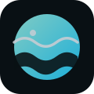

<div align="center">



# JetBrains Deep Ocean Theme

**Deep blue-black surfaces. Cool accents. One cohesive workspace.**

Four themes for your editor and IDE — balanced or Vivid, regular or Islands.

[](https://github.com/tasarren/jetbrains-deep-ocean-theme/actions/workflows/ci.yml)

[](LICENSE)

[Themes](#choose-your-depth) · [Install](#install) · [Build](#build-from-source) · [Contribute](CONTRIBUTING.md)

</div>

## More than an editor palette

- **Dark throughout.** Editor, gutters, tool windows, popups, and chrome share one surface hierarchy.
- **Color with purpose.** Cyan and teal accents, violet keywords, warm constants, and green strings.
- **Your layout, your contrast.** Keep things balanced or turn up the saturation with Vivid; use either with Islands.

## Choose your depth

| Theme | Palette | Layout |
| :--- | :--- | :--- |
| **Deep Ocean Dark** | Balanced text and cool accents | Regular |
| **Deep Ocean Dark Islands** | Same balanced palette | Islands |
| **Deep Ocean Vivid** | Brighter text and stronger syntax colors | Regular |
| **Deep Ocean Vivid Islands** | Same Vivid palette | Islands |

Requires **JetBrains IDE 2025.3+** (build 253). Native Islands rounding and gaps require **New UI**; Classic UI keeps the colors without Islands geometry.

## Install

1. Download the `deep-ocean-dark` artifact from a successful [CI run](https://github.com/tasarren/jetbrains-deep-ocean-theme/actions/workflows/ci.yml), or [build the plugin](#build-from-source).
2. If using a CI artifact, extract its outer archive to get the plugin ZIP. **Keep the plugin ZIP intact.**
3. Open **Settings → Plugins → gear menu → Install Plugin from Disk…** and select `deep-ocean-dark-<version>.zip`.
4. Restart if prompted, then open **Settings → Appearance & Behavior → Appearance → Theme** and choose your variant.

> Another theme plugin overriding the colors? Disable its UI customizations before switching to Deep Ocean.

## Build from source

Use **Java 25** and **Node 24 LTS**. No npm dependencies.

```bash
node scripts/check-deep-ocean-theme.js
./gradlew buildPlugin --no-daemon
python3 scripts/check-plugin.py
```

Plugin ZIP lands in `build/distributions/`.

## Contribute

Feature and fix PRs target **`next`**. Release PRs merge **`next` into `main`**; version changes trigger Marketplace publishing. See [CONTRIBUTING.md](CONTRIBUTING.md) for checks and release setup.

[Report a bug](https://github.com/tasarren/jetbrains-deep-ocean-theme/issues) · [Changelog](CHANGELOG.md) · [Security](SECURITY.md)

## Credits & license

Based on the ISC-licensed [One Dark theme](https://github.com/one-dark/jetbrains-one-dark-theme) by **Mark Skelton**, retaining its editor attribute coverage and UI structure. Original copyright and license notices remain in [LICENSE](LICENSE) and the packaged plugin.
